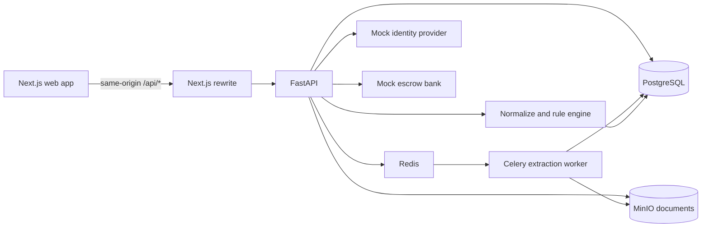

# JomiGuard

JomiGuard is a Bangladesh land-document review and monitoring demo. It helps people compare
information printed on land records, see a document-based ownership timeline, and monitor a
khatian after purchase. It reports what matched, what did not, and what to check next; it is not
a legal opinion or a title guarantee.

## Four connected features

- **Document check:** upload khatian, deed, mutation/DCR, and heir-certificate copies; review
  extracted fields, sources, mismatches, and suggested next steps.
- **Ownership timeline:** view record, sale, mutation, inheritance, and proposed-sale events from
  the case documents.
- **Bayna escrow:** follow agreement, deposit, conditions, registration, release, or refund. The
  demo bank is a mock; in a real deployment a bank partner would handle funds.
- **Probashi guardian:** compare a saved khatian snapshot with a newer copy uploaded by hand and
  review any changes.

Seller verification is a separate mock e-KYC flow attached to a case. It checks a seller name for
the demo and stores only the result; it does not collect or store NID images, selfies, phone
numbers, signatures, or NID numbers.

## Previous deed archive

Open case 00026 and choose **আগের দলিল ও প্রমাণ** to see the synthetic deed documents linked to
that land, compare extracted deed fields, open the source page, and check the stored file's
SHA-256 fingerprint. A matching fingerprint only means the stored bytes match their upload-time
baseline. It does not establish that a deed is genuine or prove ownership. Official source
verification is not connected; the page says so explicitly.

## Architecture



The API and worker run in Docker Compose. The browser talks only to Next.js at `/api`; Next.js
forwards those requests to `BACKEND_INTERNAL_URL`.

## Run locally

1. Install Docker Desktop and start it.
2. Copy `.env.example` to `.env`, set unique local values for the database, MinIO, admin login,
   and `SESSION_SECRET`. Keep `COOKIE_SECURE=false` for plain `http://localhost` development.
3. From the repository root, run:

   ```powershell
   docker compose up -d --build
   docker compose exec backend python -m app.scripts.demo_reset
   ```

4. In a second terminal:

   ```cmd
   cd frontend
   set BACKEND_INTERNAL_URL=http://localhost:8000
   npm run build && npm start
   ```

5. Open `http://localhost:3000` and sign in with `ADMIN_USERNAME` and `ADMIN_PASSWORD` from
   `.env`.

For the timed presentation and temporary public tunnel, use
[docs/demo/runbook.md](docs/demo/runbook.md).

## Privacy and demo boundaries

- Demo records and names are synthetic. Do not upload real documents to this demo.
- Never store NID numbers, NID images, selfies, face data, phone numbers, birth-registration
  numbers, or signatures. Identity storage contains verification results only.
- Gemini free-tier requests may be used to improve Google's models. Send synthetic documents
  only; never send real user documents.
- Identity verification and escrow funds are simulated. The app does not perform real e-KYC or
  hold or transfer real money.
- Findings are document checks and do not establish legal title, possession, encumbrances, or
  court status.

## Known limits

- OCR and extraction can misread scans; review source fields and the original page.
- Fingerprints detect changes to stored copies only. Government or licensed deed verification is
  not connected, and older documents without an upload-time fingerprint cannot be verified against
  their original upload.
- Timeline events and shares come from extracted text. Inheritance shares are not calculated.
- Guardian changes appear only when a newer khatian is uploaded; there is no email alert or
  automatic registry polling.
- The public Cloudflare Quick Tunnel is temporary and intended for testing, not production.
- A synthetic demo video is not stored in this repository; keep the team's recording available
  on the presentation machine as the live-demo fallback.

© 2026 Sourav Kundu Samya. All rights reserved.
